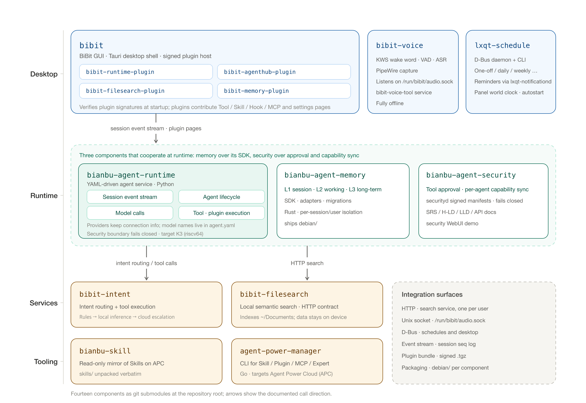

# SpacemiT Bianbu AgentOS

English | [简体中文](README_zh.md)

Bianbu AgentOS brings together the components that make up the on-device agent
operating system for SpacemiT K-series processors. The repository organizes the
components as **Git submodules**: each component keeps its own repository,
release cadence and Debian packaging, while this repository records one pinned
commit per component so a whole system image can be reproduced from a single
SHA.

## 1. Architecture



The desktop layer hosts the BiBit GUI with its signed plugins, the offline voice
service and the LXQt schedule module. The agent runtime drives sessions,
lifecycle, model calls and tool execution, with memory and security as
first-class subsystems. Capability services provide intent routing and local
semantic search, and the tooling layer mirrors Skills and manages powers. See
[docs/architecture.md](docs/architecture.md) for the full notes.

## 2. Overview

Component directories live at the root of this repository. Nothing else is
vendored here — the umbrella repository holds only the submodule pointers,
documentation and tooling.

### Runtime core

| Path | Component | Role | Stack | Branch |
|---|---|---|---|---|
| [`bianbu-agent-runtime/`](https://github.com/spacemit-com/bianbu-agent-runtime) | Bianbu Agent Runtime | YAML-driven agent service and runtime core: session event stream, agent lifecycle, model calls, tool/plugin execution, security boundary | Python | `main` |
| [`bianbu-agent-security/`](https://github.com/spacemit-com/bianbu-agent-security) | Bianbu Agent Security | Security boundary: tool approval, per-agent capability sync, `securityd` signed manifests; ships design/H‑LD/LLD docs and Debian packaging | daemon + Debian | `main` |
| [`bianbu-agent-memory/`](https://github.com/spacemit-com/bianbu-agent-memory) | Bianbu Agent Memory | Memory subsystem: L1 session drawer, L2 working drawer, L3 long-term drawer, plus SDK, adapters and migrations | Rust | `main` |
| [`bibit-intent/`](https://github.com/spacemit-com/bibit-intent) | Bibit Intent | Intent routing and tool execution: deterministic rules → local inference → cloud escalation | Python | `main` |

### Desktop and interaction

| Path | Component | Role | Stack | Branch |
|---|---|---|---|---|
| [`bibit/`](https://github.com/spacemit-com/bibit) | BiBit GUI | Desktop front end for the agent (based on Jan); chat, rich messages, attachments, session history, desktop shell | TypeScript / Rust (Tauri) | `main` |
| [`bibit-voice/`](https://github.com/spacemit-com/bibit-voice) | Bibit Voice | Offline voice service: KWS wake word, VAD, ASR, served over `/run/bibit/audio.sock` | C++ / Python | `main` |
| [`bibit-filesearch/`](https://github.com/spacemit-com/bibit-filesearch) | Bibit File Search | Local semantic file search service with an HTTP contract; data never leaves the machine | Python | `main` |
| [`lxqt-schedule/`](https://github.com/spacemit-com/lxqt-schedule) | lxqt-schedule | Schedule and reminder module for LXQt: D-Bus daemon + CLI, integrates `lxqt-notificationd`, the panel world clock and `bibit-intent` | C++ | `main` |

### BiBit plugins (frontend contributions)

| Path | Component | Role | Stack | Branch |
|---|---|---|---|---|
| [`bibit-runtime-plugin/`](https://github.com/spacemit-com/bibit-runtime-plugin) | Runtime Plugin | Settings pages for experts, providers, local models, tools, MCP, skills, hooks, plugins, security, plus Agent Top / runtime status / logs | TypeScript | `main` |
| [`bibit-agenthub-plugin/`](https://github.com/spacemit-com/bibit-agenthub-plugin) | Agent Hub Plugin | Agent Hub page and settings, host APIs over `service:store`, `file:transfer`, `job:manage`, Provider Protocol v2 | TypeScript | `bianbu-26.04` |
| [`bibit-filesearch-plugin/`](https://github.com/spacemit-com/bibit-filesearch-plugin) | File Search Plugin | Settings → Features → File Search page that configures and observes `bibit-filesearch` | TypeScript | `main` |
| [`bibit-memory-plugin/`](https://github.com/spacemit-com/bibit-memory-plugin) | Memory Plugin | Settings → Memory page: enable, retention, clear conversation, wipe, import/export | TypeScript | `main` |

### Resources and tooling

| Path | Component | Role | Stack | Branch |
|---|---|---|---|---|
| [`bianbu-skill/`](https://github.com/spacemit-com/bianbu-skill) | Bianbu Skills | Read-only mirror of the Skills published on SpacemiT APC; `skills/` is unpacked verbatim from APC packages | Markdown | `main` |
| [`agent-power-manager/`](https://github.com/spacemit-com/agent-power-manager) | Agent Power Manager | CLI that manages Skill, Plugin, MCP and Expert powers for agents | Go | `bianbu-26.04` |

> Note: `branch` in `.gitmodules` is only consulted by `--remote` operations.
> What a checkout actually pins is the commit recorded in the superproject index.

## 3. Getting the source

A recursive clone is recommended:

```bash
git clone --recurse-submodules https://github.com/spacemit-com/bianbu-agentic.git
# Or use SSH:
# git clone --recurse-submodules git@github.com:spacemit-com/bianbu-agentic.git
```

Already cloned without submodules:

```bash
cd bianbu-agentic
make init          # == scripts/submodules.sh init
```

Useful commands:

```bash
make status        # pinned commit, branch and dirty state of every component
make sync          # move every submodule to the latest commit of its tracked branch
make update        # fast-forward submodules to the commits recorded in this repo
```

`make sync` only changes the working tree. Commit the submodule pointers
afterwards if the new versions should be published.

## 4. Layout

```text
bianbu-agentic/
├── bianbu-agent-runtime/        # submodule
├── bianbu-agent-security/       # submodule
├── bianbu-agent-memory/         # submodule
├── bibit-intent/                # submodule
├── bibit/                       # submodule
├── bibit-voice/                 # submodule
├── bibit-filesearch/            # submodule
├── lxqt-schedule/               # submodule
├── bibit-runtime-plugin/        # submodule
├── bibit-agenthub-plugin/       # submodule
├── bibit-filesearch-plugin/     # submodule
├── bibit-memory-plugin/         # submodule
├── bianbu-skill/                # submodule
├── agent-power-manager/         # submodule
├── docs/                        # architecture notes for the umbrella repository
├── scripts/submodules.sh        # submodule helper
├── Makefile
└── .github/workflows/           # submodule pointer sync
```

## 5. Version policy

- Every component is pinned to a commit. An image is reproducible from the
  superproject SHA alone; `git describe` of the umbrella repository is the
  release identifier.
- `.github/workflows/sync-submodules.yml` advances the pins on `main` and commits
  them with `chore(submodule): ...` messages, so pointer bumps stay reviewable
  and separate from content changes.
- Component repositories stay authoritative for code, issues and releases. Do not
  patch a component inside this repository; send the change upstream and let the
  pointer advance.
- Two components track `bianbu-26.04` instead of `main`: `bibit-agenthub-plugin`
  and `agent-power-manager`.

## 6. Adding or removing a component

```bash
git submodule add -b main https://github.com/spacemit-com/<repo>.git <repo>
git commit -m "chore(submodule): add <repo>"
```

Then add the path to the `submodule_paths` list in
`.github/workflows/sync-submodules.yml` and to the tables above.

> Careful: while a submodule is not initialized its directory does not exist in
> the working tree, and `git add -A` / `git add .` will stage the gitlink as a
> deletion. Stage explicit paths instead, or run `make init` first.

To remove:

```bash
git submodule deinit -f -- <repo>
git rm -f <repo>
rm -rf .git/modules/<repo>
```

## 7. Documentation

- [Architecture notes (中文)](docs/architecture.md)
- Architecture diagrams: `docs/images/architecture-{zh,en}.svg`, regenerate with
  `python3 docs/images/architecture.py <zh|en> <out.svg>`
- Component READMEs under each submodule directory
