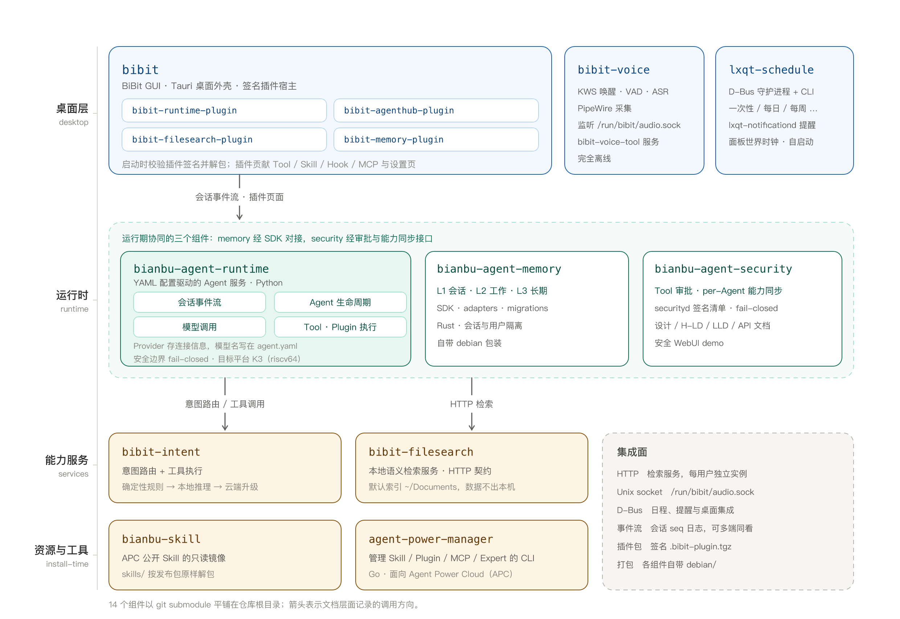

# Bianbu AgentOS 架构说明

本文件只说明「汇总仓库」层面的分工与集成面。各组件的内部实现在各自仓库的 README 与
`docs/` 中，这里不重复，也不作为权威来源。

## 1. 分层

分层是职责划分，不是编译依赖。组件之间通过下列集成面通信，没有跨仓库的头文件或链接依赖。

## 2. 集成面

| 集成面 | 参与组件 | 说明 |
|---|---|---|
| HTTP | `bibit-filesearch` | 检索服务以 HTTP 契约对外，可独立部署，也可作为 Agent 的数据层；每个登录用户一个独立实例（独立配置、数据、索引、端口） |
| Unix socket | `bibit-voice` | 语音服务监听 `/run/bibit/audio.sock`，本仓库只提供服务端、协议与文档，消费方在仓库之外 |
| D-Bus | `lxqt-schedule` | 日程守护进程经 D-Bus 与 CLI 暴露能力，提醒经 `org.freedesktop.Notifications` 显示，并与 `bibit-intent` 集成 |
| 事件流 | `bianbu-agent-runtime` | 会话历史是有连续 `seq` 的事件日志，刷新、切换会话、多端观看得到同一份投影 |
| 插件贡献 | 四个 `bibit-*-plugin` | 插件可贡献 Tool、Skill、Hook、MCP Server 与 Console 页面；插件以签名包分发，宿主启动时校验签名 |
| 配置 | `bianbu-agent-runtime` | Provider 只保存连接信息，模型名写在每个 Agent 自己的 `agent.yaml` |
| 能力与审批 | `bianbu-agent-security` | Tool 审批、per-Agent 能力同步、`securityd` 签名清单，生产模式 fail-closed |

## 3. 从仓库到镜像

组件仓库大多自带 `debian/` 打包目录，部分还带 `.bianbu-ci.yml`（面向 Bianbu CI 的构建描述）。
因此汇总仓库本身不承担编译编排，它的职责是：

1. 记录一份可复现的组件组合（每个组件一个提交）；
2. 提供一致的引导方式（`make init` / `make sync` / `make status`）；
3. 承载跨组件的架构说明与版本策略。

构建与出包仍由各组件的 `debian/rules`、CI 和 Bianbu 的镜像流水线完成，产物按 Debian 包名
（例如 `bianbu-agent-securityd`、`bianbu-agent-runtime`）进入系统镜像。

## 4. 目标硬件

`bianbu-agent-runtime` 目前只支持 SpacemiT K3（riscv64）。其余组件中，`bibit-voice`、
`lxqt-schedule` 面向 SpacemiT K3 / Bianbu Desktop，纯前端的插件与 `bianbu-skill` 与架构无关。

## 5. 版本与分支

- 默认分支为 `main`；`bibit-agenthub-plugin` 与 `agent-power-manager` 跟踪 `bianbu-26.04`。
- 汇总仓库只记录提交，不记录组件版本号；组件的 Debian 版本由其 `debian/changelog` 决定。
